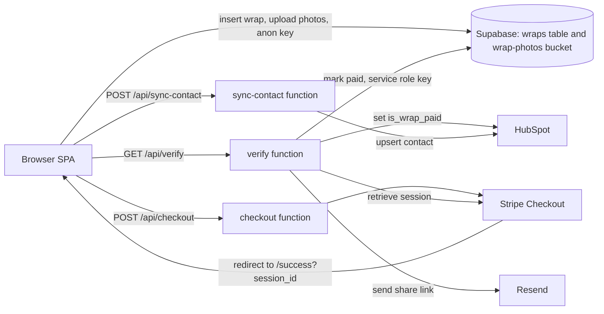

# DigiCoupleWrapped

> **Note:** The source code for this project lives in a private repository. This repository contains only the README, as a technical overview for portfolio purposes.
>
> **Live app:** https://wrapped.digicouplecards.com/

A web app that turns a couple's story into a "Spotify Wrapped"-style slideshow. Someone enters two names, an anniversary date, a song, up to five captioned photos, a one-word summary and a personal message, previews the result for free (watermarked), and pays through Stripe to unlock a clean, shareable link for their partner.

**Live site:** https://wrapped.digicouplecards.com/

It is a framework-free single-page app (Vite + vanilla JavaScript ES modules) with three Vercel serverless functions, Supabase for data and photo storage, Stripe for payments, Resend for transactional email and HubSpot for abandoned-preview follow-up.

## Features

**Creating a wrapped**
- Form with partner names, anniversary date, optional YouTube song link, a one-word summary and a message
- Photo uploader with drag-and-drop, up to 5 photos, per-photo captions and drag-to-reorder
- Client-side image compression (files over 5 MB are resized to at most 1920px) before upload
- Free, watermarked full preview before any payment

**The experience**
- Slide deck with tap, arrow-key and swipe navigation, a segmented progress bar and fullscreen on start
- Typewriter text, staggered fade-ins and floating hearts and music notes, with a per-slide animation sequence that cancels cleanly when you move on
- Live counter since the anniversary (years, months, days, hours, minutes, seconds) plus an estimated heartbeat count
- Photo grid followed by a full-screen slide per photo with its caption
- Background song played from YouTube through the IFrame API, started from the "Start Wrapped" click to satisfy browser autoplay rules
- A star constellation with one star per month together (one per day for relationships under a month old)

**Monetisation and lifecycle**
- Two plans (12-month and lifetime) at different Stripe prices, chosen in a pricing modal with an "are you sure?" exit-intent step
- Payment verified server-side before a wrap is unlocked
- Confirmation email with the share link after payment
- Unpaid previews are synced to HubSpot as contacts so an abandoned-preview email workflow can bring people back via a `/preview/:id` link
- Public landing page with FAQ, pricing section and a Terms of Service page

## Tech stack

| Area | Technology |
| --- | --- |
| Frontend | Vanilla JavaScript (ES modules), HTML, CSS, no UI framework |
| Build tooling | Vite 8 |
| Image handling | browser-image-compression |
| Database and file storage | Supabase (Postgres and Storage) via supabase-js |
| Payments | Stripe Checkout (one-time payments) |
| Email | Resend |
| CRM | HubSpot CRM v3 contacts API |
| Audio | YouTube IFrame Player API and oEmbed |
| Hosting and serverless | Vercel (static build plus Node serverless functions) |

## Architecture



### Rendering pipeline

Every view of a wrap, whether a fresh preview, a locked preview or a paid share link, goes through one entry point, `startWrapped(data, options)`. A plain data object goes in, `generateAll()` returns an array of HTML slide strings, and the app controller lays them out in a horizontal track moved with a CSS `translateX`. Because the slide builders only depend on the data object, the same code serves the create-time preview, the shared link and the locked preview, and the set of slides is decided in one place:

| Mode | Slides | Watermark |
| --- | --- | --- |
| `previewLocked` (opened from an emailed `/preview/:id` link) | Landing, intro, date, paywall | Yes |
| `preview` (just created) | Full deck, ending button is "Unlock" | Yes |
| Paid view (`/w/:id`) | Full deck, ending button is "Share" | No |

Photo, song and constellation slides are only generated when the data calls for them.

### Routing

A small custom router (`router.js`) matches `window.location.pathname` against `/w/:id`, `/preview/:id`, `/success`, `/create` and `/terms`, falling back to the landing page. `vercel.json` rewrites every non-API path to `index.html` so deep links work on a static host.

### Slide animation control

Each slide's entrance is an async sequence (wait, type a line, wait, reveal the next element). A monotonically increasing animation id is captured at the start of every sequence and checked after each `await`; when the user navigates, the id changes and the stale sequence stops. Leaving a slide resets its typed text and animation state so it replays correctly when revisited.

### Payment flow

1. The browser creates the wrap first (photos uploaded to Supabase Storage, row inserted), so the wrap id exists before checkout.
2. `/api/checkout` creates a Stripe Checkout session in `payment` mode, picks the Stripe price from the chosen plan, and stores the wrap id in the session `metadata`.
3. Stripe redirects to `/success?session_id=...`, and the page calls `/api/verify`.
4. `/api/verify` retrieves the session from Stripe and only proceeds if `payment_status` is `paid`. It reads the wrap id from the session metadata (not from anything the client sends), flips `paid` using the Supabase service role key, updates HubSpot, and sends the email.
5. The side effects run only on the first successful verification (when the wrap was not already paid), so reloading the success page does not send duplicate emails. HubSpot and email failures are caught and logged without failing the unlock.

If the user leaves checkout, the preview is stashed in `sessionStorage` so returning to `/create` restores their preview instead of an empty form.

### Abandoned-preview recovery

When a wrap is created, the browser fires a non-blocking request to `/api/sync-contact`, which upserts a HubSpot contact keyed on email with custom properties (`wrap_id`, `wrap_created_at`, `is_wrap_paid`, `partner_name`, `wrap_preview_url`). A HubSpot workflow can then email unpaid users a link to their locked preview. `/api/verify` flips `is_wrap_paid` to `true` on payment so the workflow stops.

## Data model

A single Supabase table, `wraps`, with these columns as used by the code:

| Column | Notes |
| --- | --- |
| `id` | UUID generated in the browser with `crypto.randomUUID()` |
| `name1`, `name2` | The two partners' names |
| `anniversary` | Date string |
| `youtube_url` | Optional song link |
| `word`, `message` | The one-word summary and personal message |
| `email` | Buyer's email, used for receipts and CRM |
| `photos` | JSON array of `{ url, caption }` |
| `paid` | Boolean, set to true only by the server after Stripe confirms payment |

Photos live in a Supabase Storage bucket named `wrap-photos` under `<wrapId>/<index>.<ext>`.

## Security model

- **Payment is verified server-side.** The unlock decision comes from the Stripe API, keyed by the session id, never from a client-supplied flag or wrap id.
- **Privileged credentials never reach the browser.** Only the Supabase anon key is exposed (via Vite `VITE_` variables). The Stripe secret key, Supabase service role key, Resend key and HubSpot token are read only inside serverless functions.
- **Idempotent unlock.** Repeated calls to `/api/verify` for the same session are safe.
- **Method and input checks** on each function (405 for wrong HTTP method, 400 for missing fields).
- **Failure isolation.** Third-party calls that are not essential (CRM sync, email) cannot block a customer from getting their link.
- Client-side validation of photo count, type and size, and of email and YouTube URL formats.

## Project structure

```
api/
  checkout.js        Create Stripe Checkout session
  verify.js          Confirm payment, unlock wrap, send email, update CRM
  sync-contact.js    Upsert HubSpot contact for abandoned-preview emails
assets/              Landing page hero video
css/                 landing.css, slides.css, styles.css
js/
  main.js            Entry point: routes, form submit, checkout redirect
  router.js          Pathname-based route resolution
  app.js             Slide controller: navigation, progress, animation sequencing
  slides.js          Slide HTML builders and pricing modal
  animations.js      Hearts, notes, countdown, typewriter
  photoUploader.js   Drop zone, compression, captions, reorder
  photos.js          Validation and Supabase Storage upload
  supabase.js        Insert and fetch wraps
  youtube.js         IFrame API player, video id parsing, oEmbed title
  landing.js         Landing page scroll-reveal and floating hearts
index.html           Landing page, Terms, create form and wrapped screens
vercel.json          Rewrites for API and SPA fallback
vite.config.js
```

## Local development

The project uses `npm run dev`, `npm run build` and `npm run preview` (Vite), and `vercel dev` to run the serverless functions alongside the frontend. It needs a Supabase project (a `wraps` table and a `wrap-photos` storage bucket), a Stripe account with two one-time prices, and optionally Resend and HubSpot accounts.

### Configuration

Environment variable names (values are never committed):

| Variable | Used by |
| --- | --- |
| `VITE_SUPABASE_URL` | Browser |
| `VITE_SUPABASE_ANON_KEY` | Browser |
| `SUPABASE_URL` | `api/verify` |
| `SUPABASE_SERVICE_ROLE_KEY` | `api/verify` |
| `STRIPE_SECRET_KEY` | `api/checkout`, `api/verify` |
| `STRIPE_PRICE_ID` | 12-month plan |
| `STRIPE_PRICE_ID_2` | Lifetime plan |
| `RESEND_API_KEY` | `api/verify` (optional) |
| `RESEND_FROM_EMAIL` | `api/verify` (optional, has a default) |
| `HUBSPOT_ACCESS_TOKEN` | `api/sync-contact`, `api/verify` (optional) |
| `SITE_URL` | Base URL for redirect and share links; falls back to `VERCEL_URL`, then localhost |
